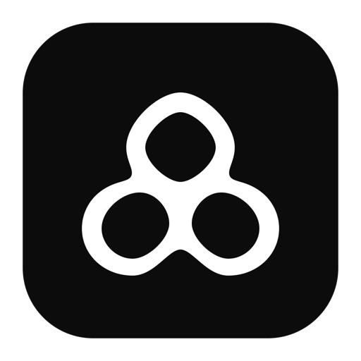
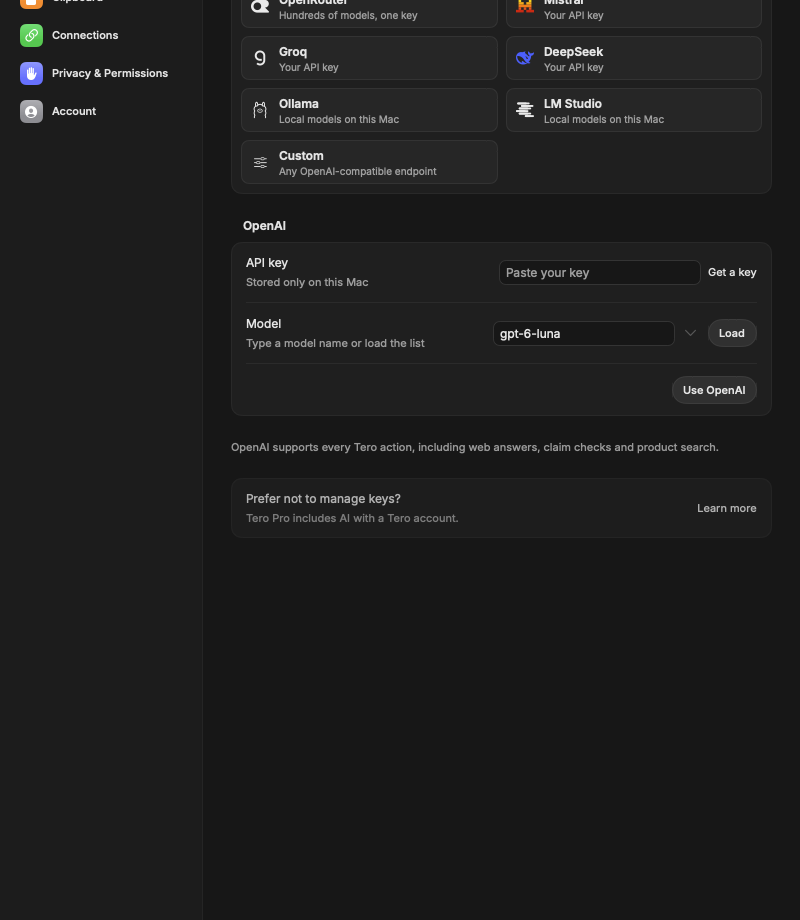

<p align="center">
  
</p>

<h1 align="center">Tero</h1>

<p align="center">
  <strong>Do more with what you select on your Mac.</strong><br>
  Select text, a link or files in any app, press <kbd>⌘</kbd> <kbd>\</kbd>, and pick what to do next.
</p>

<p align="center">
  <a href="https://teroflow.app">Website</a> ·
  <a href="https://github.com/aymenn8/tero-releases/releases/latest">Download</a> ·
  <a href="https://teroflow.app/docs">Manual</a> ·
  <a href="https://teroflow.app/changelog">Changelog</a>
</p>

<p align="center">
  
  
  
  
</p>

---

Tero is a native macOS assistant that lives behind one shortcut. It reads what you've selected, suggests the actions that fit, and runs them in place: correct a sentence, reply to a message, turn a date into a calendar event, rename a file or save a video. It's free, works without an account, and uses **your own AI provider**, or a model running on your Mac.

## Features

| | |
|---|---|
| **Writing** | Correct, Rewrite (natural, professional, casual), Adjust tone, Simplify, Improve prompt, Translate (12 languages), Clean formatting, Change case |
| **Reading** | Explain, Key points, Extract tasks, Check a claim (with sources), Ask anything (with web answers) |
| **Replies** | Three suggested intents for the message you selected, then a draft in its language |
| **Planning** | Create Reminders or Calendar events from a message, always reviewed before saving |
| **Numbers & places** | Calculate, convert units, currencies and time zones, open in Maps or get directions |
| **Files** | Rename and batch rename with AI suggestions, move to a folder, summarize images, PDFs and Office documents |
| **Videos** | Download a YouTube link as MP4 or MP3 into the folder you choose (uses your installed `yt-dlp`) |
| **Clipboard** | Local, searchable clipboard history with pins, files, images and links |
| **Your own actions** | Describe a habit in plain words and Tero turns it into a reusable action |

Everything is keyboard first: arrows to choose, <kbd>Return</kbd> to run, <kbd>Esc</kbd> to step back. Every action can have its own global shortcut.

## Bring your own AI

Tero doesn't resell AI. Add a key in **Settings → AI** and requests go **straight from your Mac to the provider you chose**. Your key is stored in the macOS Keychain and never reaches Tero's servers.

<p align="center">
  
</p>

| Provider | Protocol | Web answers & claim checks |
|---|---|---|
| OpenAI | Responses API | ✓ |
| Anthropic (Claude) | Messages API | ✓ |
| OpenRouter | OpenAI-compatible | ✓ |
| Grok (xAI), Google Gemini, Mistral, Groq, DeepSeek | OpenAI-compatible | — |
| Ollama, LM Studio | Local, OpenAI-compatible | — |
| Any OpenAI-compatible endpoint | OpenAI-compatible | — |

Prefer not to manage keys? **Tero Pro** is an optional subscription with AI included, available from the website.

## Install

Download the latest notarized build from [Releases](https://github.com/aymenn8/tero-releases/releases/latest), drag Tero to Applications, then grant **Accessibility** access when asked so Tero can read your selection. Tero updates itself with [Sparkle](https://sparkle-project.org).

To download videos, install the tools once:

```bash
brew install yt-dlp ffmpeg
```

## Build from source

Requirements: macOS 14 or later, Xcode 26 or later with Swift 6, Node.js 24 (for the gateway tests).

```bash
git clone https://github.com/aymenn8/tero.git
cd tero
open Tero.xcodeproj   # scheme "Tero Dev"
```

The project is set up for the maintainer's Apple team. To run it yourself, select the **Tero** target → **Signing & Capabilities**, choose your own team, and change the bundle identifier if Xcode asks. The **Tero Dev** scheme builds a separate development app with its own settings and Keychain items.

From the command line:

```bash
xcodebuild -project Tero.xcodeproj -scheme 'Tero Dev' -destination 'platform=macOS' build
```

### Tests

```bash
swift test                          # core logic (Swift Testing + XCTest)
make check                          # account and ranking gateway checks (Node)
python3 Scripts/test-byok.py        # bring-your-own-key engine against a synthetic provider
```

UI fixtures such as `Scripts/test-panel-layout.py` briefly open real panels on your Mac and use synthetic data only.

## How it works

```
Selection (Accessibility, Finder) ──► Recommendations ──► Action bubbles ──► Action
                                          │                                   │
                                   local rules, optional                own AI key ──► provider
                                   semantic ranking (Pro)               Tero Pro   ──► Supabase gateway
```

| Path | What lives there |
|---|---|
| `Sources/Core` | Pure, testable logic (the `TeroCore` Swift package): action catalogue, recommendations, parsers, file workflows |
| `Sources/Panel` | The floating panel controller and keyboard routing |
| `Sources/Selection` | Accessibility capture and revalidation of the selected text, range and app |
| `Sources/AI` | `LocalGateway` and `AIProviderClient` for your own key, and the Tero Pro gateway client |
| `Sources/UI`, `Sources/Settings` | SwiftUI views, the shared action bubbles and Settings |
| `Sources/Clipboard`, `Sources/Habits`, `Sources/Planning` | Clipboard history, personal actions, Reminders and Calendar |
| `Resources/AI/Prompts.json` | The prompts used for every AI action |
| `supabase/functions` | Tero Pro backend: `tero-correct`, `tero-rank`, `tero-shop`, `tero-account`, `tero-events` |
| `supabase/migrations` | Database schema for accounts, usage, prompts and the action catalogue |

The app ships pointing to the hosted Tero backend, which only serves Tero Pro accounts. With your own key, Tero works fully without it.

## Privacy

- Clipboard history and your personal actions stay on your Mac (personal actions sync only if you sign in).
- With your own key, the content an action needs is sent only to your provider. With a local model, nothing leaves your Mac.
- Tero never logs selected text, prompts or clipboard content.

More in the [privacy policy](https://teroflow.app/privacy).

## Contributing

Issues and pull requests are welcome. Please read [CONTRIBUTING.md](CONTRIBUTING.md) first, and report security issues privately as described in [SECURITY.md](SECURITY.md).

## License

Tero is released under the [MIT License](LICENSE). Bundled third-party components keep their own licenses: Sparkle (`Resources/Sparkle-LICENSE.txt`), Inter (`Assets/Fonts/Inter-OFL.txt`), Lobe Icons (`Resources/LobeIcons-LICENSE.txt`) and Beautiful UI (`Notices/BeautifulUI.txt`).
